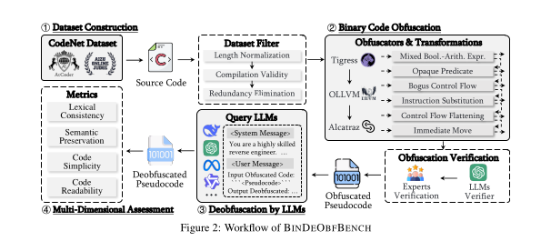

# BinDeObfBench: Overview

## Challenges Addressed

| ID | Challenge | Description |
|----|-----------|-------------|
| **C1** | Lack of realistic/diverse datasets | Existing work focuses on single architecture/limited techniques; real-world uses multi-technique, self-obfuscating programs |
| **C2** | No comprehensive evaluation metrics | Prior work uses only semantic correctness → prevents holistic quality assessment |
| **C3** | Knowledge gap from distribution shift | Obfuscation creates irregular control flows + high entropy (noise) → mapping becomes challenging |

---

## Solutions (S1–S3)

### S1: Large-Scale Diverse Dataset
- Built from scratch: diverse ISAs, compilation settings, obfuscation transformations
- 3 key stages: **source code → IR → binary**

### S2: Multi-Dimensional Assessment Metrics

| Dimension | Metric | Purpose |
|-----------|--------|---------|
| **Lexical Consistency** | BLEU | n-gram overlap (identifiers, keywords, syntax) |
| **Semantic Preservation** | Dual-Perspective Semantic Fusion | Behavioral consistency (ROC-AUC, PR-AUC) |
| **Code Conciseness** | Token-wise Delta Entropy | Token-level uncertainty reduction |
| **Code Readability** | Halstead Complexity | Cognitive effort (volume, difficulty, effort) |

### S3: Bridging LLM Knowledge Gap
- **In-context learning** to adapt to obfuscated binaries
- **ReCopilot**: Pre-trained on broad binary code spectrum
- **ChatDEOB**: Supervised fine-tuning specifically for deobfuscation

---

