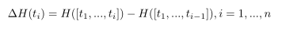
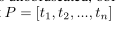
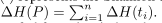

# BinDeObfBench: Multi-Dimensional Assessment

## Motivation
Prior studies rely on limited metrics (e.g., semantic correctness only) → cannot holistically assess deobfuscation quality.

---

## Four Evaluation Dimensions

### 1. Lexical Consistency
- **What**: Textual alignment between recovered & ground-truth code
- **Captures**: Identifier naming, function signatures, syntactic structure
- **Metric**: **BLEU score** (n-gram overlap)

### 2. Semantic Preservation
- **What**: Behavioral equivalence (not syntactic match)
- **Method**: **Dual-Perspective Semantic Fusion**
  1. **Explicit features**: Jaccard similarity on obfuscation-resilient features (extracted via Qwen2.5-Coder-1.5B-Instruct)
  2. **Implicit features**: Learned semantic embeddings
  3. **Fusion**: Linear combination weighted by coefficient $\alpha$
- **Metrics**: ROC-AUC (global discriminative ability), PR-AUC (positive identification robustness)

### 3. Code Simplicity (Conciseness)
- **What**: Reduction of obfuscation-induced complexity
- **Metric**: **Token-wise Delta Entropy**
  - Measures incremental token contribution to sequence information complexity
  - Evaluated on: Unobfuscated → Obfuscated → Deobfuscated
  - **Formula**: $\Delta H = H_{deobf} - H_{obf}$ (negative = successful simplification)

**Where P:**

**To calculate:**

### 4. Code Readability
- **What**: Cognitive effort to comprehend code
- **Metric**: **Halstead Complexity**
  - **Volume** = information content
  - **Difficulty** = cognitive complexity
  - **Effort** = Volume × Difficulty (primary focus)
  - Based on operator/operand count & diversity

---

## Summary Table

| Dimension | Primary Metric | Target |
|-----------|----------------|--------|
| Lexical Consistency | BLEU | ↑ Higher = better match |
| Semantic Preservation | ROC-AUC / PR-AUC | ↑ Higher = better behavioral match |
| Code Simplicity | Token-wise Delta Entropy | ↓ Lower = simpler |
| Code Readability | Halstead Effort | ↓ Lower = more readable |