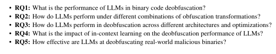

# BinDeObfBench: Evaluation Setup

## Hardware & Runtime

| Resource | Specification |
|----------|---------------|
| OS | Ubuntu 24.10 |
| CPU | 256 cores |
| RAM | 436 GB |
| Disk | 100 TB |
| GPU | 8 × NVIDIA RTX A6000 |
| Total runtime | 15 days |

- **Local deployment**: Qwen & Llama models
- **API calls**: Other models (GPT-4o, DeepSeek-R1, etc.)

---

## Research Questions

| RQ | Question |
|----|----------|
| **RQ1** | Overall LLM performance on binary code deobfuscation |
| **RQ2** | Performance under different obfuscation intensity levels |
| **RQ3** | Performance across compilation environments (ISA, opt level) |
| **RQ4** | Impact of in-context learning (few-shot) |
| **RQ5** | Generalization to real-world malware deobfuscation |

---

## Navigation

- [[06_RQ1_Overall_Performance]]
- [[07_RQ2_Obfuscation_Levels]]
- [[08_RQ3_Compilation_Environments]]
- [[09_RQ4_In_Context_Learning]]
- [[10_RQ5_Malware_Generalization]]